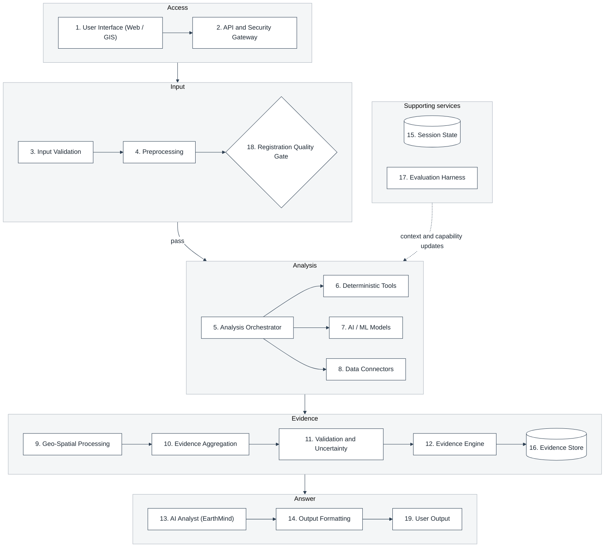
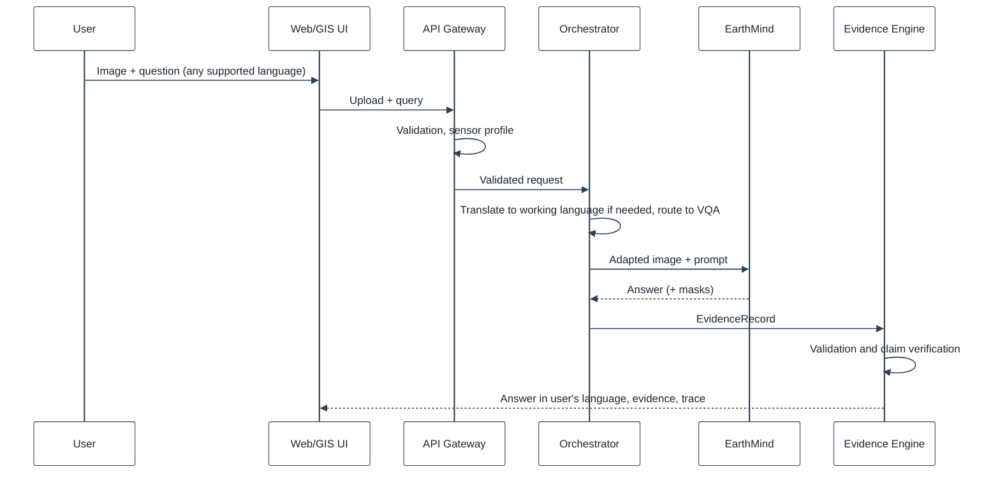
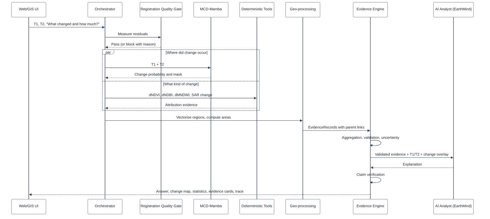
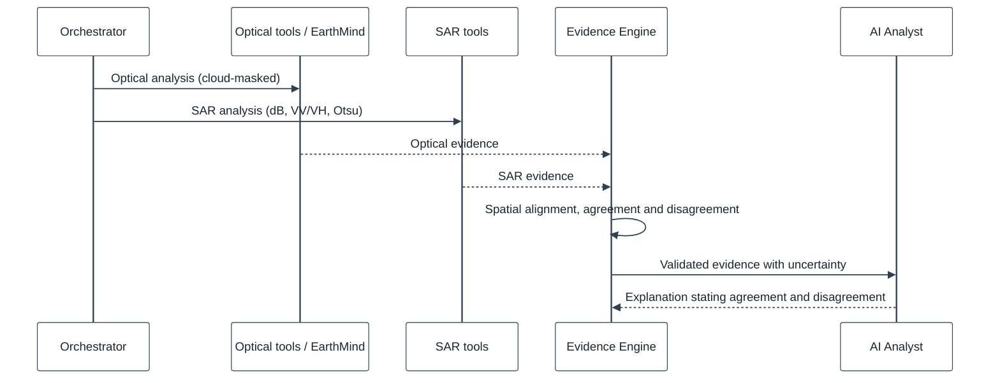
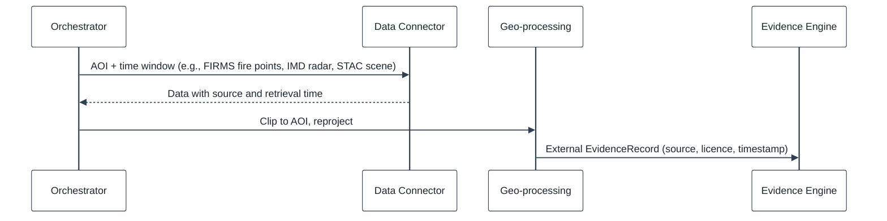

# System Architecture Document (SAD)

## 1. DOCUMENT CONTROL

| Attribute | Details |
| :--- | :--- |
| **Document ID** | SQ-DOC-002 |
| **Document Title** | System Architecture Document |
| **Project** | SatQuery AI (Problem Statement 26167) |
| **Organization** | Indian Space Research Organisation (ISRO), Department of Space |
| **Team** | Chitravits |
| **Version** | 4.0.0 |
| **Date** | 6 October 2026 |

---

## 2. ARCHITECTURAL OVERVIEW

### 2.1 Architecture Style and Rationale

SatQuery AI is a **modular monolith with a capability-aware orchestration layer and an Evidence Engine**, with GPU models served as separate services.

1. **Capabilities first, models second.** The orchestrator decides which capabilities and evidence a question needs before selecting tools and models.
2. **Evidence as the integration contract.** Every tool and model returns the same execution contract and produces EvidenceRecords, so specialists can be added or replaced without changing the orchestration.
3. **Gates before analysis.** Input validation and the Registration Quality Gate run before pair analysis.
4. **Isolated model services.** EarthMind and MCD-Mamba have incompatible software stacks and GPU requirements and run as independent services.
5. **Staged infrastructure.** The scientific MVP does not require the full production stack.

### 2.2 End-to-End Pipeline

```text
User query + imagery (+ optional AOI, any supported language)
        |
API + Security Gateway
        |
Input Validation
        |
Preprocessing + Registration Quality Gate
        |
Analysis Orchestrator (intent -> data assessment -> tool/model selection -> execution)
   |                    |                       |
Deterministic Tools   AI/ML Models           External Data Connectors
   |                    |                       |
        Geo-Spatial Processing (shared service)
        |
Evidence Aggregation -> Validation + Uncertainty -> Evidence Engine
        |
AI Analyst (EarthMind) -> Claim Verification
        |
Output Formatting -> Answer + Map + Evidence + Trace (in the user's language)
```

### 2.3 Architecture Blocks



---

## 3. COMPONENT ARCHITECTURE

Each block lists its responsibilities and the prototype status.

### 3.1 Block 1 - User Interface (Web / GIS)

| Function | Prototype Status |
|---|---|
| Natural-language query | Implemented |
| Image and image-pair upload | Implemented |
| Analysis history | Implemented |
| AOI drawing (polygon, rectangle) | Planned |
| Interactive map and layers | Planned |
| Before / after slider | Planned |
| Evidence panel | In Progress |
| Metrics dashboard (usage) | Implemented; evaluation metrics Planned |
| Language selection | Planned (settings field exists, English only) |

Technology in the prototype: React 19, Vite 8, Tailwind CSS 4, Radix / shadcn.

### 3.2 Block 2 - API and Security Gateway

| Function | Prototype Status |
|---|---|
| FastAPI REST endpoints | Implemented |
| Input validation and sanitisation; typed identifiers | Implemented |
| File upload security (type, signature, size, pixel limit) | Implemented |
| JWT authentication | Planned |
| Role-based access control: ISRO_ANALYST, NDRF_OFFICER, PUBLIC_RESEARCHER | Planned |
| Rate limiting of expensive jobs | Planned |
| Object-level authorisation (protection against OLA / BOLA) | Planned |
| Audit logging | Planned (audit table exists) |

### 3.3 Block 3 - Input Validation

Validates file format (GeoTIFF/TIFF), CRS and georeferencing, band availability, resolution and dimensions, NoData and metadata, temporal pair checks, optical-SAR compatibility and resource limits. Prototype Status: Implemented (sensor identification for Sentinel-1, Sentinel-2, Cartosat and RISAT; evidence-based modality; declarative workflow requirements; ordered pair check).

### 3.4 Block 4 - Preprocessing and Block 18 - Registration Quality Gate

Prepares analysis-ready data: raster loading and metadata, band selection and remapping, reflectance and calibration (optical and SAR), cloud and shadow handling, band alignment and resampling, temporal co-registration, common-grid creation, windowing and tiling, and model input preparation.

**Registration Quality Gate:** before change or fusion analysis, measures geospatial residuals of T1/T2 pairs, blocks pairs that exceed the sensor- and resolution-specific threshold, validates temporal alignment and logs the reason for any block. Prototype Status: raster loading Implemented; model input preparation In Progress; residual measurement Planned (the prototype currently checks CRS, aspect ratio and dimensions).

### 3.5 Block 5 - Analysis Orchestrator

Understands the query, plans, selects tools and models and executes the workflow (LangGraph).

| Stage | Function | Prototype Reference |
|---|---|---|
| Intent understanding | What the user needs; analysis type (spectral, SAR, temporal); required output; query language | Agent `understand_query`; orchestrator intent-classifier interface |
| Data assessment | Available imagery, sensor and modality, bands and resolution, temporal availability, AOI and spatial context | Orchestrator `validate_inputs`; agent `preprocess` |
| Tool / model selection | Deterministic tools, AI/ML models, external data needs, execution plan, dependencies | Orchestrator `route`; agent `plan_tools` |
| Execution | Run tools and models, fetch external data, manage parallelism, handle failures and retries | Orchestrator `execute_step`; agent `execute_tools` |
| Outputs to next stage | Analysis results, intermediate outputs, logs and metadata | Orchestrator `compose_response`; agent `aggregate_results` |

Routing selects capabilities first; when planner confidence is insufficient, deterministic routing by input configuration is used. Prototype Status: routing and contract Implemented; agent pipeline In Progress.

### 3.6 Block 6 - Deterministic Analysis Tools

| Group | Tools |
|---|---|
| Spectral | NDVI, EVI, SAVI, NDWI, MNDWI, NDBI, NDMI, NBR, BAI |
| SAR | dB conversion, VV/VH, VV/VH ratio, RVI, SAR-Otsu, flood candidate |
| Temporal | Pixel difference, temporal ratio, MAD, temporal Otsu, change statistics |

Prototype Status: Planned.

### 3.7 Block 7 - AI/ML Models

| Group | Models | Scope | Prototype Status |
|---|---|---|---|
| EarthMind (VLM) | VQA, captioning, location reasoning, multimodal reasoning; RSUniVLM optional | Core | In Progress |
| MCD-Mamba | Bi-temporal change, change mask, change VQA (with EarthMind) | Core | In Progress |
| Grounding / detection | Grounding DINO, SAM2, object detection, text to region; GeoGround | Optional | GeoGround client In Progress; others Planned |
| Specialist models | TACMT (SAR grounding), DoFA, others as needed | Experimental | Planned |

All models are integrated through the registry contract (`05_technical_design.md` Section 3) and served as separate HTTP services.

### 3.8 Block 8 - Data Connectors (External Sources)

Real-time and additional data: Microsoft Planetary Computer (STAC), Copernicus CDSE, NASA Earthdata, ISRO Bhuvan, CAMS (PM2.5), IMD Monsoon Radar, NASA FIRMS (fire), NASA EONET (disasters), USGS (earthquakes), NOAA / NCEI, NASA GIBS, AISStream (shipping), OSM / Overpass, Copernicus Marine and others as needed. Scope: Future. Prototype Status: Planned. Detail: `06_data_strategy.md` Section 8.

### 3.9 Block 9 - Geo-Spatial Processing (Shared Service)

| Component | Functions | Prototype Status |
|---|---|---|
| Raster operations (Rasterio) | Read and write rasters, pixel values, CRS and affine transform, windowing and tiling, resampling | Implemented (reading, metadata, previews) |
| GDAL | Reprojection and warping, resampling, raster conversion, large-raster operations | Implemented through Rasterio |
| Vector / geometry (GeoPandas, Shapely) | Mask to polygon, AOI intersection, buffer and distance, area and centroid | Planned |
| CRS (PyProj) | CRS transformation, UTM to WGS84, projection operations | Implemented (footprint to WGS84) |

Example flow: pixel result (mask or box), georeferencing, pixel to CRS coordinates, Shapely geometry, PyProj / GeoPandas, WGS84 GeoJSON / PostGIS.

### 3.10 Block 10 - Evidence Aggregation

Combines model outputs (answers, captions, detections, masks, change maps, confidence), tool outputs (spectral indices, SAR metrics, statistics, geometry), geospatial evidence (coordinates, areas, AOI intersections, CRS transforms) and external evidence (satellite, environmental, crisis and contextual data). Output: valid, valid with warnings, or failed, with an uncertainty score. Prototype Status: In Progress (agent aggregation; evidence rows of type claim, change region, measurement and output file).

### 3.11 Block 11 - Validation and Uncertainty

Checks the results (not the input): data validation (imagery, bands, sensor, modality, metadata), tool and model validation (output structure, numerical sanity, mask validity), spatial validation (geometry validity, CRS consistency, alignment) and evidence consistency (cross-checking results, handling disagreement, aligning confidence). Output: valid, valid with warnings, or failed, with an uncertainty score. Prototype Status: Planned.

### 3.12 Block 12 - Evidence Engine

Traceability and provenance. Each EvidenceRecord stores the source image, bands, CRS and transform, preprocessing information, model or tool and version, parameters and thresholds, intermediate outputs, statistics, validation results and timestamps, linked as source image, analysis, tool or model, intermediate result, mask / detection / raster / statistics. Prototype Status: In Progress (result and evidence records stored; parent links and parameters Planned).

### 3.13 Block 13 - AI Analyst (EarthMind)

Interprets validated evidence: understands the user's intent, interprets results, explains reasoning at the level of evidence and references the evidence used. Input: validated evidence and context. The AI Analyst does not introduce figures that are not present in the evidence; claim verification follows. Prototype Status: Planned.

### 3.14 Block 14 - Output Formatting

Presents results: text answer, map overlay, evidence panel, detections and polygons, masks, statistics and metrics, coordinates, before / after view, metadata and a reproducible report, translated into the user's language where required. Prototype Status: text answer and PDF report Implemented / In Progress; map and multilingual output Planned.

### 3.15 Block 15 - Session State

Maintains context across follow-up queries: session management, conversation history, loaded data and AOI context, cached results and intermediate outputs. Prototype Status: Implemented (conversations retain images and jobs).

### 3.16 Block 16 - Evidence Store

Persistent storage for evidence: model outputs, masks and results, indexed by query, AOI and timestamp, enabling follow-up queries and linking to maps and visualisations. Prototype Status: storage Implemented (PostgreSQL and object storage); AOI indexing Planned.

### 3.17 Block 17 - Evaluation Harness

Feeds the capability registry: automated testing (VQA, detection, change), metrics (mAP@0.5, IoU, accuracy), model and tool comparison, evaluation reports and capability-registry updates. A model is enabled for a capability only when the harness shows it meets the acceptance threshold. Prototype Status: automated software tests Implemented; model evaluation Planned.

### 3.18 Block 19 - User Output

Answer, map and evidence: natural-language response, interactive map overlays, metrics and statistics, evidence references, confidence and uncertainty, and a reproducible report.

---

## 4. DATA FLOW DIAGRAMS

### 4.1 Single-Image VQA



### 4.2 Change Analysis (MCD-Mamba to EarthMind)



### 4.3 Optical-SAR Analysis



Learned cross-attention fusion remains experimental until a compatible checkpoint and ablation demonstrate benefit.

### 4.4 External Data Enrichment



---

## 5. DEPLOYMENT ARCHITECTURE

### 5.1 Topology

| Stage | Composition |
|---|---|
| Prototype (MVP) | Frontend, FastAPI, sequential model and tool execution, local or object storage. The current prototype uses Vercel (interface), Render (API in Docker) and Supabase (PostgreSQL and storage), with model services on a GPU host (serverless GPU or team workstation through a secure tunnel). |
| Scale-out | Redis / Celery, PostgreSQL / PostGIS, MinIO or S3-compatible storage, multiple GPU workers |

Production infrastructure is not a prerequisite for the scientific MVP.

### 5.2 GPU Allocation

- Sequential model loading, quantisation where compatible, tiling and cached preprocessing; all models resident in GPU memory is not assumed.
- EarthMind requires approximately 9 GB per variant at FP16; MCD-Mamba requires Linux or WSL2 with CUDA and its compiled kernel.
- The local 4 GB development GPU is used for development only.

### 5.3 Configuration

Model service addresses, checkpoint paths and versions, sensor profiles, registration tolerances, tile size, language settings, connector credentials, storage locations and security settings are configuration, not code.

---

## 6. CROSS-CUTTING CONCERNS

### 6.1 Observability
Every request has an identifier; every step records tool or model and version, parameters, outputs, evidence identifiers and timing. The execution trace exposes operational events only, never hidden model reasoning.

### 6.2 Error Handling
Validation failures return specific codes; registration failures block change and fusion analysis; model failures trigger retry, a task-compatible fallback, a partial answer or an explicit failure; unverifiable claims are removed or qualified.

### 6.3 Security
Gateway controls as in Section 3.2; external connector credentials held server-side; model services authenticated with a service key.

### 6.4 Performance
Cached preprocessing and deterministic results; tiling of large scenes; workers added only when measured load requires.

---

## 7. TECHNOLOGY STACK SUMMARY

| Layer | Technologies |
| :--- | :--- |
| Frontend | React, TypeScript / JavaScript, Tailwind CSS; web map library (planned) |
| API | FastAPI, Pydantic |
| Orchestration | LangGraph |
| Models | EarthMind-4B, MCD-Mamba; GeoGround, Grounding DINO, SAM2, TACMT, DoFA, RSUniVLM (optional / experimental); PyTorch, Hugging Face, PEFT |
| Geospatial | Rasterio, GDAL, GeoPandas, Shapely, PyProj |
| Data | PostgreSQL (PostGIS at scale-out), object storage |
| Multilingual | Language identification and Indian-language translation service (Section 6.8 of `05_technical_design.md`) |
| Infrastructure | Docker, NVIDIA Container Toolkit; Redis / Celery at scale-out |

---
*End of Document*
