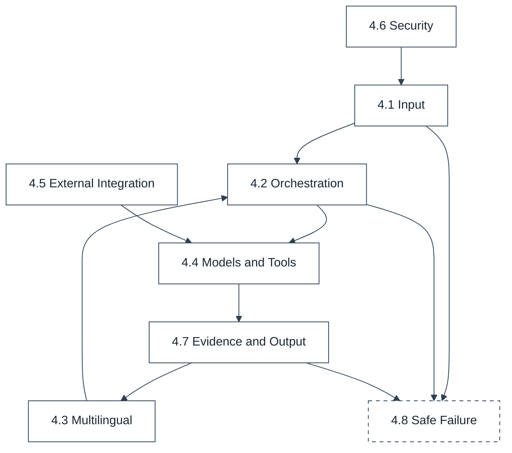

# Functional Requirements Specification

## 1. DOCUMENT CONTROL

| Attribute | Details |
| :--- | :--- |
| **Document ID** | SQ-DOC-003 |
| **Document Title** | Functional Requirements Specification |
| **Project** | SatQuery AI (Problem Statement 26167) |
| **Team** | Chitravits |
| **Version** | 4.0.0 |
| **Date** | 6 October 2026 |

## 2. SCOPE AND PURPOSE

This specification defines the functions SatQuery AI must provide. Priority uses MoSCoW (Must, Should, Could). Prototype Status follows `00_document_index.md` Section 3. Traceability refers to REQ-01 to REQ-10 in `01_solution_overview.md` Section 5.

## 3. USER ROLES AND ACTORS

| Role | Description |
|---|---|
| ISRO_ANALYST | Remote sensing analyst with full analysis and evidence access |
| NDRF_OFFICER | Disaster-response officer focused on rapid hazard and change queries |
| PUBLIC_RESEARCHER | Researcher with access to public data and own uploads |
| System Administrator | Manages deployment, model services, sensor profiles, connectors and tolerances |
| ISRO/SAC Evaluator | Evaluates on held-out Cartosat-2S and RISAT data |

## 4. FUNCTIONAL REQUIREMENTS

### 4.1 Input

| ID | Requirement | Priority | Acceptance Criteria | Prototype Status | Trace |
| :--- | :--- | :--- | :--- | :--- | :--- |
| FR-IMG-001 | Accept GeoTIFF/TIFF and prescribed benchmark PNG/JPEG. | Must | File stored and registered; invalid files rejected with a specific code. | Implemented | REQ-07 |
| FR-IMG-002 | Extract CRS, bounds, GSD, dates, band count, dtype and NoData. | Must | Values match GDAL / Rasterio reference output. | Implemented | REQ-07 |
| FR-IMG-003 | Validate sensor, modality and band/polarization semantics. | Must | Wrong modality and missing bands rejected with specific codes. | Implemented (sensor and band identification; polarization rule Planned) | REQ-06 |
| FR-IMG-004 | Register T1/T2 pairs. | Must | Pair aligned on a common grid; every reprojection and resampling recorded. | Planned (pair compatibility checks Implemented) | REQ-05 |
| FR-IMG-005 | Register optical/SAR pairs. | Must | Pair aligned with polarization and radiometric metadata preserved. | Planned | REQ-06 |
| FR-IMG-006 | Run the Registration Quality Gate for pair workflows. | Must | Pairs beyond tolerance blocked with the reason logged. | Planned | REQ-05 |
| FR-IMG-007 | Check target feasibility against GSD where relevant. | Should | Resolution warning for targets below a configured multiple of GSD. | Planned | REQ-09 |
| FR-IMG-008 | Accept an area of interest drawn on the map (polygon or rectangle). | Should | Analysis restricted to the AOI; AOI stored in session state. | Planned | REQ-10 |

### 4.2 Query and Orchestration

| ID | Requirement | Priority | Acceptance Criteria | Prototype Status | Trace |
| :--- | :--- | :--- | :--- | :--- | :--- |
| FR-AGT-001 | Map natural-language queries to capabilities. | Must | Capability-routing accuracy measured on a curated query set. | In Progress | REQ-01 |
| FR-AGT-002 | Build dependency-aware workflows. | Must | Plans match reference plans for compound queries. | In Progress | REQ-01 |
| FR-AGT-003 | Select compatible tools/models from the registry. | Must | No tool executed outside its declared input requirements; unregistered model yields `MODEL_NOT_AVAILABLE`. | Implemented | REQ-01 |
| FR-AGT-004 | Record an operational execution trace. | Must | Every run, including failures, produces a trace; no chain-of-thought exposed. | In Progress | REQ-09 |
| FR-AGT-005 | Use deterministic routing when planner confidence is insufficient. | Must | Low-confidence plans fall back to routing by input configuration; logged in the trace. | Implemented | REQ-01 |
| FR-QRY-001 | Maintain session context and follow-up questions. | Must | Follow-ups reuse prior assets, AOI and evidence identifiers. | Implemented (assets and history); Planned (AOI, evidence reuse) | REQ-01 |

### 4.3 Multilingual Queries

| ID | Requirement | Priority | Acceptance Criteria | Prototype Status | Trace |
| :--- | :--- | :--- | :--- | :--- | :--- |
| FR-LNG-001 | Accept queries in English and supported Indian languages (initially Hindi, then additional scheduled languages). | Should | Language detected or taken from user preference; recorded in the trace. | Planned | REQ-01 |
| FR-LNG-002 | Translate non-English queries into the working language for planning and model prompts. | Should | Routing accuracy on translated queries within an agreed margin of English queries. | Planned | REQ-01 |
| FR-LNG-003 | Return the answer in the user's language while preserving numbers, units, place names and evidence identifiers exactly. | Should | Figures in the translated answer identical to the verified English answer. | Planned | REQ-09 |
| FR-LNG-004 | Allow the user to view the original and translated text. | Could | Both versions available in the evidence panel. | Planned | REQ-09 |

### 4.4 Models and Tools

| ID | Requirement | Priority | Acceptance Criteria | Prototype Status | Trace |
| :--- | :--- | :--- | :--- | :--- | :--- |
| FR-VQA-001 | EarthMind single-image VQA. | Must | Answer stored with an EvidenceRecord; unsupported band configurations rejected by the adapter. | In Progress | REQ-02 |
| FR-CAP-001 | Scene description. | Must | Caption stored with an EvidenceRecord. | In Progress | REQ-03 |
| FR-GRD-001 | Text-guided region localisation. | Must | Regions returned and displayed as evidence. | In Progress | REQ-04 |
| FR-GRD-002 | Optional GeoGround specialist. | Should | Enabled only if it outperforms the baseline. | In Progress (client) | REQ-04 |
| FR-GRD-003 | Optional Grounding DINO and SAM2 for open-vocabulary detection and segmentation. | Could | Enabled through the evaluation harness. | Planned | REQ-04 |
| FR-DET-001 | Spectral indices where required bands exist. | Must | NDVI, EVI, SAVI, NDWI, MNDWI, NDBI, NDMI, NBR, BAI verified against reference values. | Planned (band requirements validated) | REQ-06 |
| FR-DET-002 | SAR dB/VV/VH/RVI/Otsu where compatible. | Must | Linear and dB units handled correctly. | Planned | REQ-06 |
| FR-DET-003 | Temporal difference/MAD/Otsu/statistics. | Must | Verified on synthetic pairs. | Planned | REQ-05 |
| FR-CHG-001 | MCD-Mamba change detection through an input adapter. | Must | Change mask produced with the trained configuration; unsupported channels rejected. | In Progress | REQ-05 |
| FR-CHG-002 | Change VQA using T1/T2 and change evidence (MCD-Mamba to EarthMind pipeline). | Must | EarthMind explanation references MCD-Mamba and attribution evidence; evaluated on CDVQA. | Planned | REQ-05 |
| FR-CHG-003 | Separate change detection from semantic attribution. | Must | Change types stated only when supported by spectral or semantic evidence. | In Progress | REQ-05 |

### 4.5 External Integration

| ID | Requirement | Priority | Acceptance Criteria | Prototype Status | Trace |
| :--- | :--- | :--- | :--- | :--- | :--- |
| FR-EXT-001 | Integrate external models through the registry contract as HTTP model services. | Should | A new model is added without orchestration changes; declares capabilities, inputs, outputs, resources and confidence method. | In Progress (contract and model service protocol) | REQ-01 |
| FR-EXT-002 | Enable an external model for a capability only after evaluation-harness acceptance. | Should | Registry entry records the evaluation result and version. | Planned | REQ-09 |
| FR-CON-001 | Retrieve external data through connectors (STAC, Copernicus, NASA, Bhuvan, IMD and others). | Could | Data clipped to the AOI and stored as external evidence with source, licence and timestamp. | Planned | REQ-06 |

### 4.6 Security and Access

| ID | Requirement | Priority | Acceptance Criteria | Prototype Status | Trace |
| :--- | :--- | :--- | :--- | :--- | :--- |
| FR-SEC-001 | JWT authentication and role-based access control. | Should | Roles ISRO_ANALYST, NDRF_OFFICER and PUBLIC_RESEARCHER enforced. | Planned | REQ-10 |
| FR-SEC-002 | Object-level authorisation for assets, results and evidence. | Should | Access to another user's objects rejected. | Planned | REQ-10 |
| FR-SEC-003 | Audit logging of security-sensitive actions. | Should | Uploads, deletions and role changes logged. | Planned | REQ-09 |

### 4.7 Evidence and Output

| ID | Requirement | Priority | Acceptance Criteria | Prototype Status | Trace |
| :--- | :--- | :--- | :--- | :--- | :--- |
| FR-EVD-001 | Generate an EvidenceRecord for each analytical result. | Must | Every tool and model output maps to an evidence identifier. | In Progress | REQ-09 |
| FR-EVD-002 | Link derived evidence to parent evidence. | Must | Evidence graph traversable from claim to source asset. | Planned | REQ-09 |
| FR-EVD-003 | Verify quantitative/geospatial claims before the final response. | Must | Evidence Support Rate recorded; unsupported claims removed or qualified. | Planned | REQ-09 |
| FR-RPT-001 | Display answer, evidence, overlays and uncertainty. | Must | Evidence cards linked to map geometry. | In Progress | REQ-09, REQ-10 |
| FR-RPT-002 | Export report/GeoJSON where applicable. | Should | Report with query, answer, evidence, parameters, versions and trace. | Implemented (PDF report); Planned (GeoJSON) | REQ-10 |

### 4.8 Safe Failure

| ID | Requirement | Priority | Acceptance Criteria | Prototype Status | Trace |
| :--- | :--- | :--- | :--- | :--- | :--- |
| FR-SAF-001 | Request T2 when a change question has one image. | Must | No change claim produced. | Implemented | REQ-05 |
| FR-SAF-002 | Explain when required bands are missing (for example, NIR for NDVI). | Must | Specific explanation, no value. | Implemented (validation) | REQ-06 |
| FR-SAF-003 | Block change analysis when registration fails. | Must | Analysis blocked with the reason. | Implemented (pair compatibility); Planned (residual gate) | REQ-05 |
| FR-SAF-004 | Warn when GSD is insufficient for the target. | Should | Warning shown with the answer. | Planned | REQ-09 |
| FR-SAF-005 | Return a qualified answer or explicit failure when evidence is insufficient. | Must | No confident fabricated answer in reliability tests. | In Progress | REQ-09 |

## 5. REQUIREMENT PRIORITY MATRIX

| Module | Must | Should | Could | Total |
| :--- | :--- | :--- | :--- | :--- |
| 4.1 Input | 6 | 2 | 0 | 8 |
| 4.2 Query and Orchestration | 6 | 0 | 0 | 6 |
| 4.3 Multilingual Queries | 0 | 3 | 1 | 4 |
| 4.4 Models and Tools | 9 | 1 | 1 | 11 |
| 4.5 External Integration | 0 | 2 | 1 | 3 |
| 4.6 Security and Access | 0 | 3 | 0 | 3 |
| 4.7 Evidence and Output | 4 | 1 | 0 | 5 |
| 4.8 Safe Failure | 4 | 1 | 0 | 5 |
| **Total** | **29** | **13** | **3** | **45** |

## 6. REQUIREMENT DEPENDENCIES

- Change VQA (FR-CHG-002) depends on FR-IMG-006, FR-CHG-001, FR-DET-001 to FR-DET-003 and FR-EVD-001 to FR-EVD-003.
- Multilingual output (FR-LNG-003) is produced only after claim verification (FR-EVD-003), so translation cannot alter verified figures.
- External models (FR-EXT-001) are enabled only through the evaluation harness (FR-EXT-002).
