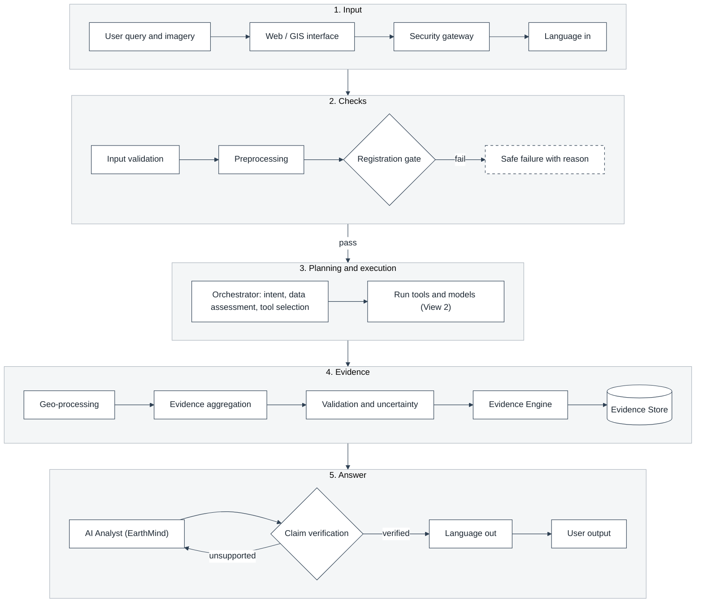
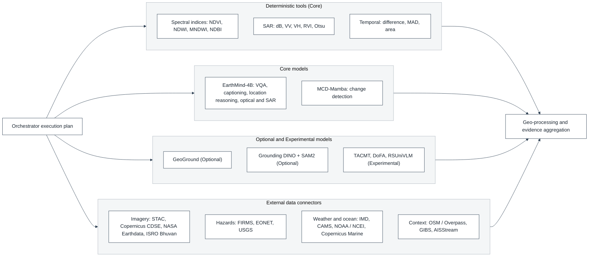
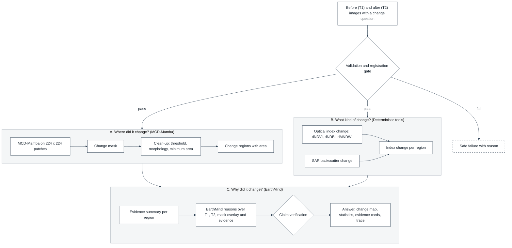

# Technical Design Document - Models, Tools, Evidence and Orchestration

## 1. DOCUMENT CONTROL

| Attribute | Details |
| :--- | :--- |
| **Document ID** | SQ-DOC-005 |
| **Document Title** | Technical Design Document |
| **Project** | SatQuery AI (Problem Statement 26167) |
| **Organization** | Indian Space Research Organisation (ISRO), Department of Space |
| **Team** | Chitravits |
| **Version** | 4.2.0 |
| **Date** | 6 October 2026 |

Where the design is implemented or partially implemented in the prototype, the relevant code module is cited (`backend/app/...`).

---

## 2. END-TO-END SYSTEM FLOW

The system is shown in three views so that each diagram stays readable:

| View | Question It Answers |
|---|---|
| View 1: System flow (Section 2.1) | What happens to a query, step by step, from the user to the answer? |
| View 2: Models and tools (Section 2.2) | What can the orchestrator call in the execution step? |
| View 3: MCD-Mamba to EarthMind pipeline (Section 2.3) | How is a change question answered? |

### 2.1 View 1: System Flow

Every query passes through five stages. The registration gate and claim verification are the two checkpoints: a query that fails the gate stops with a reason, and an answer that contains an unsupported claim is sent back to the AI Analyst for revision.



| Stage | What Happens |
|---|---|
| 1. Input | The user submits imagery and a question in the Web / GIS interface. The security gateway checks identity, role and rate limits. A non-English question is translated to English, with place names and numbers protected (Section 6.8). |
| 2. Checks | Files are validated (format, CRS, bands, sensor profile, pair rules) and preprocessed. Image pairs must pass the Registration Quality Gate before any change analysis. |
| 3. Planning and execution | The orchestrator identifies the intent, assesses the data, selects tools and models from the capability registry and runs them (View 2). |
| 4. Evidence | Outputs are converted to map units, aggregated, checked for uncertainty and stored as EvidenceRecords. |
| 5. Answer | EarthMind writes the answer from the evidence only. Claim verification checks every statement; the verified answer is translated back to the user's language with figures copied unchanged. |

Session State (conversation context) and the Evaluation Harness (which decides which models the registry may select) work alongside this flow and are described in Sections 3 and 6.

### 2.2 View 2: Models and Tools

In the execution step the orchestrator calls only what the plan needs. Deterministic tools measure; models detect, ground and describe; connectors add external context. All outputs go to geo-processing and evidence aggregation.



### 2.3 View 3: MCD-Mamba to EarthMind Pipeline

A change question is answered in three parts. MCD-Mamba finds where the change is, deterministic tools measure what kind of change it is within each changed region, and EarthMind explains it using only that evidence. Full specification: Section 7.



| Part | Component | Output |
|---|---|---|
| A. Where did it change? | MCD-Mamba (opt_only, sar_only or multimodal) | Change mask, cleaned change regions and their area |
| B. What kind of change? | Deterministic tools on T1 and T2 | dNDVI, dNDBI, dMNDWI and SAR backscatter change for each region from Part A |
| C. Why did it change? | EarthMind AI Analyst and claim verification | Verified answer with change map, statistics, evidence cards and execution trace |

### 2.4 Flow per Query Type

| Query Type | Path Through the System |
|---|---|
| Single-image VQA or captioning | Validation, preprocessing, orchestrator, EarthMind-4B, evidence aggregation, AI Analyst, claim verification, output |
| Object grounding | As VQA, with GeoGround or Grounding DINO plus SAM2 producing boxes or masks that pass through geo-processing |
| Spectral or SAR measurement | Deterministic tools compute the index or backscatter statistic; geo-processing computes area; the AI Analyst explains the measured values only |
| Change VQA ("what changed and why") | View 3: registration gate, MCD-Mamba change regions, deterministic attribution evidence, EarthMind explanation (Section 7) |
| Optical and SAR together | EarthMind multi-sensor path and MCD-Mamba multimodal mode; fusion is at evidence level, not pixel level |
| External context (fire, flood, weather) | Data connectors add external evidence records with source, licence and retrieval time |
| Non-English query | Language In before validation; Language Out after claim verification, so translation never alters verified figures (Section 6.8) |

### 2.5 Prototype Status of the Flow

| Block | Prototype Status | Code Reference |
|---|---|---|
| User Interface (chat, upload, validation panel) | Implemented | `src/` (frontend) |
| API and Security Gateway | In Progress (API implemented; JWT, RBAC and rate limiting Planned) | `backend/app/api/routes/`, `backend/app/core/security.py` |
| Language In / Language Out | Planned (settings `language` field exists, English only) | `backend/app/schemas/settings.py` |
| Input Validation and sensor identification | Implemented | `backend/app/validation/` |
| Preprocessing and Registration Quality Gate | In Progress (pair checks Implemented; residual gate Planned) | `backend/app/validation/change_detection_validator.py`, `backend/app/services/raster_service.py` |
| Analysis Orchestrator | Implemented (validate_inputs, route, execute_step, compose_response); model registry empty on main | `backend/app/orchestrator/`, `backend/app/ml/registry.py` |
| Agent pipeline (understand_query to response_generation) | In Progress (feat/agent-bridge, `AGENT_ENABLED`) | `backend/app/agent_bridge/` |
| EarthMind-4B and MCD-Mamba model services | In Progress (`/v1/health`, `/v1/predict` protocol defined) | `backend/app/ml/contracts.py` |
| MCD-Mamba to EarthMind pipeline | Planned | Section 7 |
| Deterministic tools | Planned | Section 5.6 |
| Data connectors | Planned | Section 8 |
| Evidence Store and Session State | Implemented (Supabase Postgres and private bucket) | `backend/app/db/supabase.py`, `backend/app/services/storage_service.py` |
| Evidence Engine, claim verification | Planned | Section 9 |
| Evaluation Harness | Planned | `09_evaluation_strategy.md` |

---

## 3. CAPABILITY REGISTRY

### 3.1 Registry Contract

Every model and tool declares:

`id, version, capabilities, input requirements, output schema, supported sensors/modalities, resource requirements, confidence method, fallbacks, evaluation status`

| Field | Purpose | Example |
|---|---|---|
| `id`, `version` | Identity; version stored in every EvidenceRecord | `earthmind-4b@adapted-v1` |
| `capabilities` | Capabilities the planner can request | VQA, captioning, location reasoning |
| `input requirements` | Sensors, modalities, bands / polarizations, band count, pair requirements | MCD-Mamba: 13 optical bands, T1 and T2 |
| `output schema` | Guaranteed output structure | text, mask, regions, statistics |
| `resource requirements` | GPU memory, timeout | approximately 9 GB, 600 s |
| `confidence method` | How confidence is produced, if at all | EarthMind: none reported |
| `fallbacks` | Task-compatible alternatives | water: MNDWI, SAR-Otsu |
| `evaluation status` | Result of the evaluation harness (Block 17) | accepted for VQA on RSVQA-LR |

**Prototype reference:** `backend/app/ml/contracts.py` defines `TaskType`, `Modality`, `ImageRole`, `ImageRef`, `ModelRequest`, `ModelResponse`, `EvidenceItem` and the `ModelService` interface; `backend/app/ml/registry.py` maps tasks to services and returns `MODEL_NOT_AVAILABLE` for any unregistered task. Input requirements, confidence method, fallbacks and evaluation status are the planned extension.

### 3.2 Model Lifecycle

- Models are served as separate services that load weights once at start-up from configured paths.
- Models are loaded sequentially; quantisation is used only where compatible and measured.
- A model is enabled for a capability only after acceptance by the evaluation harness, which writes the result into the registry.

---

## 4. STANDARD EXECUTION CONTRACT

**Input**

```text
request_id
task
input_data
parameters
```

**Output**

```text
status
result
confidence
evidence
model_id/tool_id
metadata
execution_time
error
```

The prototype's `ModelRequest` (task, query, images, context, params) and `ModelResponse` (model name and version, answer, confidence, outputs, evidence) implement this contract; `context` carries outputs of earlier plan steps, which the MCD-Mamba to EarthMind pipeline uses.

---

## 5. SPECIALIST MODEL AND TOOL SPECIFICATIONS

### 5.1 Core Registrations

| Component | Role | Scope |
|---|---|---|
| EarthMind-4B | VQA, captioning, location reasoning, EO multimodal reasoning; AI Analyst | Core |
| MCD-Mamba | Bi-temporal change detection | Core |
| GeoGround | Optional RS grounding | Optional |
| Grounding DINO, SAM2 | Open-vocabulary detection, segmentation, text to region | Optional |
| TACMT, DoFA, RSUniVLM | SAR grounding; multi-sensor features; alternative VLM | Experimental |
| Spectral tools | NDVI / EVI / SAVI / NDWI / MNDWI / NDBI / NDMI / NBR / BAI | Core |
| SAR tools | dB, VV/VH, VV minus VH / ratio, RVI, Otsu, flood candidate | Core |
| Temporal tools | Difference, ratio where valid, MAD, Otsu, change statistics | Core |
| Geo-processing | CRS, vectorisation, area, GeoJSON | Core |

### 5.2 EarthMind Adapter

The adapter owns model-specific preprocessing and prompt formatting and explicitly declares which band and polarization configurations the selected checkpoint accepts. SatQuery does not assume that an arbitrary multispectral or SAR tensor can be passed directly to EarthMind.

**Implementation reference (model service):**

| Input | View Supplied to EarthMind |
|---|---|
| Three-band 8-bit image | Unchanged |
| Sentinel-2 (12 or 13 bands) | True colour B04 / B03 / B02, 2-98 percent stretch |
| Four-band (B02, B03, B04, B08) | True colour, 2-98 percent stretch |
| SAR VV + VH | Composite VV, VH, VV minus VH, 2-98 percent stretch |
| Optical + SAR (multi-sensor weights) | `predict_forward_multi` with SAR as the image and optical as the RGB image |
| Other layouts | Rejected with `MODEL_INPUT_INVALID` |

Prompt templates: `<image>{query}` for VQA, captioning and optical-SAR analysis; `<image>Please segment {query}` for grounding (segmentation masks returned). EarthMind does not report calibrated confidence; confidence is recorded as not reported.

### 5.3 MCD-Mamba Adapter

```text
T1 + T2
 -> validation
 -> registration gate
 -> compatible model adapter
 -> MCD-Mamba
 -> change probability / mask
 -> post-processing
 -> regions + statistics
 -> EvidenceRecord
```

The selected checkpoint and configuration determine supported channels; unsupported sensor and channel combinations are rejected.

**Implementation reference (model service):** model class `STMambaBCD_multimodal`; configuration mode `opt_only`, `sar_only` or multimodal; 13 or 4 optical bands; optical inputs clipped to 0-10000 and scaled, SAR inputs clipped to -25 to 0 dB and rescaled, then per-channel 2-98 percentile normalisation; 224 x 224 patches with reflective padding; the service declines requests when no trained checkpoint is configured. Outputs: binary mask, changed pixels, changed fraction and area in square metres for projected coordinate systems.

### 5.4 Grounding and Detection Models (Optional)

GeoGround (HBB, OBB, mask), Grounding DINO (text to box) and SAM2 (box or point to mask) are registered as optional grounding providers. The orchestrator selects among them by evaluation status. Pixel outputs are georeferenced by the geo-processing service.

### 5.5 Specialist Models (Experimental)

TACMT for SAR grounding, DoFA for multi-sensor features and RSUniVLM as an alternative VLM are admitted only after ablation through the evaluation harness.

### 5.6 Deterministic Tools

| Index | Formula (Sentinel-2) |
|---|---|
| NDVI | (B8 - B4) / (B8 + B4) |
| EVI | 2.5 x (B8 - B4) / (B8 + 6 x B4 - 7.5 x B2 + 1) |
| SAVI | 1.5 x (B8 - B4) / (B8 + B4 + 0.5) |
| NDWI | (B3 - B8) / (B3 + B8) |
| MNDWI | (B3 - B11) / (B3 + B11) |
| NDBI | (B11 - B8) / (B11 + B8) |
| NDMI | (B8 - B11) / (B8 + B11) |
| NBR | (B8 - B12) / (B8 + B12) |
| BAI | 1 / ((0.1 - Red)^2 + (0.06 - NIR)^2) |

SAR tools convert linear backscatter to decibels (10 log10), compute VV/VH ratio and RVI in linear units, and apply Otsu thresholding for water and flood candidates. Temporal tools compute pixel difference, ratio where valid, MAD, temporal Otsu and change statistics. Band identity is taken from the input validation module (Sentinel-2 band tables; Cartosat MX by band position).

### 5.7 Geo-processing

Rasterio for raster I/O, transforms, windowing and resampling; GDAL for reprojection and large-raster operations; GeoPandas and Shapely for mask-to-polygon, AOI intersection, buffer, distance, area and centroid; PyProj for CRS transformation. Areas are computed in a projected CRS; outputs exported as WGS84 GeoJSON.

**Implementation reference:** `backend/app/services/raster_service.py` reads raster metadata, reprojects the footprint to WGS84 and generates previews.

---

## 6. ORCHESTRATION DESIGN

### 6.1 Intent Understanding
Determines what the user needs, the analysis type (spectral, SAR, temporal, VQA, grounding, change), the required output and the query language.

### 6.2 Data Assessment
Checks available imagery, sensor and modality, bands and resolution, temporal availability and AOI. The prototype's orchestrator derives the input configuration (single, bi-temporal, cross-modal) from image roles and modalities and rejects ambiguous inputs (`INPUT_AMBIGUOUS`, `UNSUPPORTED_INPUT`).

### 6.3 Capability-Aware Planning
The planner selects capabilities first, then models.

Example: "How many hectares of vegetation were lost?" - temporal analysis, vegetation evidence, area calculation, explanation.

`validate -> registration gate -> NDVI(T1) -> NDVI(T2) -> temporal loss evidence -> area -> validation -> EarthMind explanation -> claim verification`

### 6.4 Tool Selection and Fallback
Compatible tools and models are selected from the registry. When planner confidence is insufficient, deterministic routing by input configuration is used (implemented in `backend/app/orchestrator/routing.py`). Fallbacks must be task-compatible: water detection may fall back to MNDWI or SAR-Otsu; VQA failure cannot be replaced by a vegetation index.

### 6.5 Execution
Tools and models run sequentially or in parallel where dependencies allow; external data is fetched through connectors; failures trigger retry, fallback, partial answer or explicit failure.

### 6.6 Evidence Aggregation and Validation
Model, tool, geospatial and external evidence are combined; outputs are validated for structure, numerical sanity, mask validity, geometry validity, CRS consistency and cross-evidence consistency, producing a status (valid, valid with warnings, failed) and an uncertainty score.

### 6.7 AI Analyst and Claim Verification
EarthMind receives the validated evidence and context and writes the explanation, referencing evidence identifiers. Claim verification extracts every number, unit, location and change statement from the explanation and matches it to an EvidenceRecord. Unsupported claims are removed or qualified; if the answer cannot be supported, the result is `ERR_UNVERIFIED_CLAIM`.

### 6.8 Multilingual Query Processing

Multilingual support allows field users to ask questions and read answers in Indian languages while all analysis runs on a single working language (English), which is the language EarthMind and the planner are prompted in.

```text
User query (any supported language)
  -> language identification (or user preference)
  -> translation to English, with protected spans:
       numbers, units, dates, coordinates, place names, sensor and band names
  -> normal pipeline (planning, tools, models, evidence, claim verification)
  -> verified English answer
  -> translation to the user's language, with figures, units and
     evidence identifiers copied verbatim from the verified answer
  -> response with both versions available
```

| Design Point | Specification |
|---|---|
| Initial languages | English and Hindi, followed by other scheduled Indian languages |
| Translation service | Candidate open-source Indic translation models (for example, IndicTrans2) or the Government of India Bhashini platform; selected by evaluation |
| Protected spans | Numbers, units, dates, coordinates, place names and technical terms are masked before translation and restored afterwards |
| Order of operations | Translation of the answer happens after claim verification, so translation cannot alter verified values |
| Trace | Detected language, source of the language decision, translation service and version recorded in the trace |
| Failure | If translation fails, the verified English answer is returned with a notice |

**Prototype reference:** the user settings schema already includes a `language` field (currently English only), and the agent's query structure carries `language`, `input_type` and a language-source provenance field, which this design populates.

---

## 7. MCD-MAMBA TO EARTHMIND PIPELINE

### 7.1 Purpose
MCD-Mamba establishes **where change occurred**. EarthMind explains **what changed and why it matters**, using only validated evidence. Semantic attribution requires additional T1/T2 evidence, spectral evidence or a semantic model.

### 7.2 Pipeline

The same diagram is shown in Section 2.3.


### 7.3 Stage Specification

| Stage | Input | Output | Evidence |
|---|---|---|---|
| Change detection | Validated T1, T2 | Change probability and binary mask | `CHANGE_MASK` (model, version, threshold) |
| Post-processing | Mask | Regions, region areas, changed fraction | `CHANGE_REGIONS` (parent: mask) |
| Attribution | T1, T2 bands | Index differences per region | `SPECTRAL_CHANGE` per index (parents: T1, T2) |
| Aggregation | All of the above | Region table with change area and index deltas | `CHANGE_SUMMARY` |
| Explanation | T1, T2, overlay of the mask, change summary | Text referencing evidence identifiers | `EXPLANATION` (parent: summary) |
| Verification | Explanation, evidence | Verified or qualified answer | Verification record |

### 7.4 Prompting EarthMind
EarthMind receives the change summary as structured context (region identifiers, areas, index deltas and their evidence identifiers) together with the T1 and T2 views and an overlay of the mask. The prompt instructs the model to describe changes only for listed regions and to reference evidence identifiers. Figures in the explanation must match the summary.

### 7.5 Plan Representation
In the orchestrator, change VQA is represented as a two-step plan, `CHANGE_DETECTION` followed by `CHANGE_VQA`, with the first step's output passed as context to the second (`TASK_PLANS` in `backend/app/orchestrator/routing.py`; currently one step per task).

---

## 8. EXTERNAL MODEL INTEGRATION

### 8.1 Integration Pattern
External models join SatQuery as HTTP model services that implement the execution contract and declare a registry entry. The orchestrator is unchanged when a model is added.

```text
Model service (own environment, GPU)
  GET  /v1/health  -> ready, model name, version, tasks
  POST /v1/predict -> task, query, images, context, params -> ModelResponse
Errors: MODEL_NOT_AVAILABLE (503), MODEL_INPUT_INVALID (422), MODEL_EXECUTION_FAILED (500)
```

### 8.2 Admission Process

1. Wrap the model as a service implementing the protocol.
2. Declare the registry entry (capabilities, input requirements, output schema, resources, confidence method, fallbacks).
3. Run the evaluation harness on the capability benchmarks.
4. Enable the model for a capability only if it meets the acceptance threshold or improves on the current provider.
5. Record the evaluation result and version in the registry.

### 8.3 Candidate External Models

| Model | Capability | Scope |
|---|---|---|
| GeoGround | Grounding (HBB, OBB, mask) | Optional |
| Grounding DINO | Open-vocabulary detection | Optional |
| SAM2 | Segmentation from prompts | Optional |
| TACMT | SAR grounding | Experimental |
| DoFA | Multi-sensor foundation features | Experimental |
| RSUniVLM | Alternative RS VLM | Experimental |

### 8.4 Security
Model services are authenticated with a service key, accept only declared inputs, and never access storage directly; the API service supplies image content.

**Prototype reference:** the model service protocol and reference servers for EarthMind and MCD-Mamba are in the repository's AI integration reference code; the agent integration configures EarthMind, MCD-Mamba and GeoGround service addresses and keys and allows each optional service to be disabled.

---

## 9. EVIDENCE RECORD AND EXECUTION TRACE

### 9.1 EvidenceRecord

```text
evidence_id
request_id
parent_evidence_ids[]
source_asset_ids[]
sensor
modality
bands_or_polarizations[]
CRS
spatial_extent
operation
tool/model ID + version
parameters
output reference
statistics
confidence
uncertainty
language (for explanation records)
processing notes
timestamp
```

**Prototype reference:** results and evidence are stored with evidence types claim, change region, measurement and output file, each with its producing tool; parent links and parameters are the planned extension.

### 9.2 Execution Trace
Operational events: classification, language detection, validation, selected tools and models, parameters, outputs, evidence identifiers, timing and verification result. Hidden chain-of-thought is not exposed.

---

## 10. INFERENCE OPTIMISATION

Sequential model loading, quantisation where compatible, tiling and cached preprocessing. All models resident in GPU memory is not assumed. Batch processing of tiles within a model call where memory allows.

---

## 11. SAFE FAILURE

Fallbacks are task-compatible. Missing T2, missing required bands, poor registration, unsupported sensor, insufficient resolution and insufficient evidence produce a warning, request for data, partial answer or explicit failure. An unavailable model results in a recorded failure, never placeholder text.

---
*End of Document*
