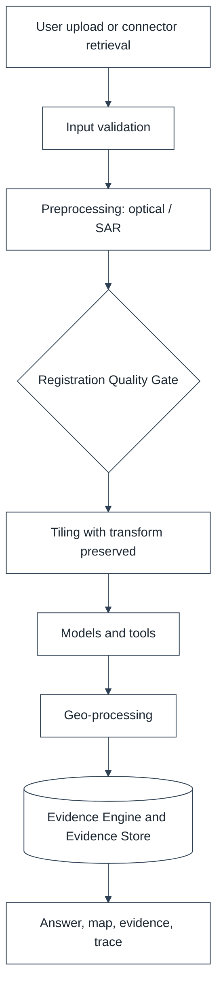

# Data Strategy and Dataset Documentation

## 1. DOCUMENT CONTROL

| Attribute | Details |
| :--- | :--- |
| **Document ID** | SQ-DOC-006 |
| **Document Title** | Data Strategy and Dataset Documentation |
| **Project** | SatQuery AI (Problem Statement 26167) |
| **Organization** | Indian Space Research Organisation (ISRO), Department of Space |
| **Team** | Chitravits |
| **Version** | 4.0.0 |
| **Date** | 6 October 2026 |

---

## 2. DATASET ROLES

| Dataset | Role |
|---|---|
| **BigEarthNet.txt** | Main candidate for EO VLM adaptation and evaluation. 464,044 co-registered Sentinel-1 / Sentinel-2 image pairs and about 9.6 million text annotations. Treated as an adaptation resource, not as proof that SatQuery has already been fine-tuned. |
| **VRSBench** | Captioning, grounding and VQA evaluation where compatible. |
| **RSVQA** | Remote sensing VQA evaluation with question-type breakdowns. |
| **CDVQA** | Change-oriented VQA evaluation of the MCD-Mamba to EarthMind pipeline. |
| **OSCD** | Change-mask evaluation for MCD-Mamba (the dataset used by its data loader). |
| **ISRO/SAC set** | Held-out Cartosat-2S / RISAT evaluation. Never tuned on hidden annotations. |
| **Multilingual query set** | Curated EO questions in English and Hindi (then other scheduled languages) with reference intents, for evaluating translation and routing. |

### 2.1 BigEarthNet.txt Notes
An inspected sample showed Sentinel-1 VV and VH at about 120 x 120 pixels (float32, decibel-like values) and Sentinel-2 bands at their native resolutions (about 120 x 120 for 10 m, 60 x 60 for 20 m, 20 x 20 for 60 m bands) with CRS EPSG:32633; these describe the sample only. The imagery is approximately 100 GB compressed, so it is processed as subsets with streaming loaders.

---

## 3. SENTINEL-2

All thirteen bands (B1 to B12 and B8A) are recognised. Band identity and native resolution remain metadata.

| Index | Bands |
|---|---|
| NDVI | NIR + Red |
| NDWI | Green + NIR |
| MNDWI | Green + SWIR |
| NDBI | SWIR + NIR |

All bands are not forced into a VLM unless the selected checkpoint explicitly supports them.

**Implementation reference:** the validation module identifies Sentinel-2 bands from band names (B01 to B12, B8A) and, for unnamed files confirmed as Sentinel-2, from the 13-, 12- or 4-band layout.

## 4. SENTINEL-1

VV, VH or VV+VH is represented explicitly. Whether values are amplitude, intensity, sigma-naught or dB is preserved.

## 5. CARTOSAT-2S / RISAT

Treated as domain-shift cases. Sensor, GSD, bands and polarizations, radiometric representation, acquisition time and CRS are preserved and never silently mapped to Sentinel semantics.

**Implementation reference:** Cartosat MX bands are addressed by position (blue, green, red, NIR) and PAN as a single band; RISAT is treated as SAR. Naming patterns and band order are to be confirmed against product metadata.

---

## 6. PREPROCESSING

### 6.1 Optical
1. Metadata validation.
2. Product-level and unit checks.
3. Cloud and shadow masking when available.
4. Band selection.
5. Required resampling.
6. Model- or tool-specific normalisation.
7. Tiling with the source transform preserved.

### 6.2 SAR
1. Validate product representation.
2. Radiometric calibration when required.
3. dB conversion when required.
4. Optional or configured speckle filtering.
5. Preserve polarization metadata.
6. Model- or tool-specific normalisation.

### 6.3 Model-Specific Normalisation (Implementation Reference)

| Consumer | Normalisation |
|---|---|
| EarthMind | RGB view: true colour B04 / B03 / B02 or SAR composite (VV, VH, VV minus VH), 2-98 percent stretch |
| MCD-Mamba | Optical clipped to 0-10000 and scaled; SAR clipped to -25 to 0 dB and rescaled; per-channel 2-98 percentile normalisation; 224 x 224 patches |
| Deterministic tools | Physical reflectance or backscatter; no display stretching |

### 6.4 Pair Alignment
Every reprojection and resampling operation is recorded, and the Registration Quality Gate runs before change or fusion analysis.

### 6.5 Tiling
Each model tile retains the source asset, pixel window, affine transform, CRS and overlap so outputs can return to the source grid.

---

## 7. ADAPTATION

Evaluate `base EarthMind versus adapted EarthMind` on held-out data. Record checkpoint, dataset split and preprocessing configuration. Adaptation uses parameter-efficient methods (LoRA or adapters) on BigEarthNet.txt subsets, with geographically stratified splits to prevent leakage.

---

## 8. EXTERNAL DATA CONNECTORS

Connectors provide real-time or additional data for an AOI and time window. Every retrieved item becomes an external EvidenceRecord with source, licence, retrieval time and AOI.

| Connector | Data | Typical Use |
|---|---|---|
| Microsoft Planetary Computer (STAC) | Sentinel-1/2, Landsat and other collections | Fetch T1/T2 scenes when the user has none |
| Copernicus CDSE | Sentinel products | Scene retrieval |
| NASA Earthdata | MODIS, Landsat and other products | Scene retrieval and context |
| ISRO Bhuvan | Indian thematic layers and imagery services | Indian context layers |
| CAMS | Air quality (PM2.5) | Environmental context |
| IMD Monsoon Radar | Rainfall and radar | Flood context |
| NASA FIRMS | Active fire detections | Fire and burn analysis |
| NASA EONET | Natural event catalogue | Disaster context |
| USGS | Earthquakes | Damage-assessment context |
| NOAA / NCEI | Climate and weather records | Context |
| NASA GIBS | Global imagery tiles | Base maps and quick looks |
| AISStream | Ship positions | Maritime context |
| OSM / Overpass | Roads, buildings, land use | Reference geometry |
| Copernicus Marine | Ocean data | Coastal and marine context |

Rules: connector data never replaces measurement from the user's imagery without being labelled as external; connector credentials are held server-side; retrieved data is cached by AOI and time window; licence terms are recorded with the evidence. Scope: Future. Prototype Status: Planned.

---

## 9. MULTILINGUAL DATA

- A curated query set in English and Hindi (and later other scheduled languages) with reference capability labels and expected outputs.
- A protected-term glossary (sensor names, band names, indices, units, Indian place names) used to mask terms during translation.
- Evaluation of translation quality on EO-specific phrasing and of routing agreement between translated and English queries.

---

## 10. DATA-QUALITY GATES

Valid file, supported sensor, required channels, valid CRS for spatial tasks, valid NoData, compatible dimensions and acceptable registration.

**Implementation reference:** file validation (signature, type, readability, 400-megapixel limit, permitted data types), sensor and modality identification, band requirements per workflow and an ordered pair compatibility check are implemented in `backend/app/validation/`.

---

## 11. DATA FLOW

