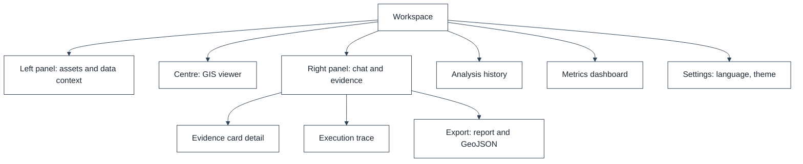

# UI/UX Design Document

## 1. DOCUMENT CONTROL

| Attribute | Details |
| :--- | :--- |
| **Document ID** | SQ-DOC-008 |
| **Document Title** | UI/UX Design Document |
| **Project** | SatQuery AI (Problem Statement 26167) |
| **Organization** | Indian Space Research Organisation (ISRO), Department of Space |
| **Team** | Chitravits |
| **Version** | 4.0.0 |
| **Date** | 6 October 2026 |

---

## 2. DESIGN PHILOSOPHY

The interface hides GIS configuration complexity without hiding evidence. For every answer the user sees:

**Question - What SatQuery did - What it measured - Where it is - How certain it is**

### 2.1 Target Users

| Role | Needs |
|---|---|
| ISRO_ANALYST | Full evidence, parameters, versions and traces |
| NDRF_OFFICER | Fast, clearly qualified answers for hazard and change queries, in the officer's language |
| PUBLIC_RESEARCHER | Reproducible results and exportable reports |

### 2.2 Principles
- Conversational interaction in English or a supported Indian language.
- Evidence-first answers: every claim linked to an evidence card and, where spatial, to map geometry.
- Visible uncertainty and disagreement.
- Operational trace, never private model reasoning.
- Safe failure presented as guidance.

---

## 3. INFORMATION ARCHITECTURE

---

## 4. WORKSPACE DESIGN

### 4.1 Left Panel - Data Context

Asset inventory, sensor and modality, bands and polarizations, GSD, CRS, acquisition dates, pair status, registration quality, and external data sources added to the session.

### 4.2 Centre - GIS Viewer

Source imagery, before / after slider, optical / SAR side-by-side, change mask, grounding regions, uncertainty layer, measurements, and AOI drawing tools (polygon and rectangle). Layers can be toggled with opacity control and legends that show units and thresholds.

### 4.3 Right Panel - Chat and Evidence

Chat, language selector, suggested queries (only for capabilities the inputs support), answer, confidence and uncertainty, evidence cards, execution trace and export.

### 4.4 Prototype Status

| Element | Prototype Status |
|---|---|
| Chat, single and pair upload, analysis history | Implemented |
| Pair rejection panel showing both images' values | Implemented |
| PDF report export | Implemented |
| Usage metrics dashboard | Implemented |
| Answer display with output images and tool steps | In Progress |
| GIS viewer, AOI drawing, before / after slider, optical / SAR view | Planned |
| Evidence cards linked to geometry | Planned |
| Language selector and translated answers | Planned (settings field exists) |

---

## 5. EVIDENCE CARD

Shows claim, source, tool or model, parameters, measurement, spatial extent, confidence, uncertainty and parent evidence. Selecting a card highlights its geometry; selecting a region lists the supporting cards. For translated answers, the card shows the claim in the user's language with the original English text available.

---

## 6. SPECIALISED VIEWS

### 6.1 Change-VQA View (MCD-Mamba to EarthMind)
`T1 | change mask | T2` with linked evidence cards, measured area and statistics, a region table with index changes, and the EarthMind explanation referencing evidence identifiers.

### 6.2 Optical-SAR View
Optical result, SAR result, Agreement and Disagreement, rather than hiding conflicting evidence.

### 6.3 External Context View
External layers (for example, FIRMS fire points, IMD radar, OSM roads) shown with source and retrieval time, clearly distinguished from measurements on the user's imagery.

---

## 7. SAFE-FAILURE UX

| Situation | Behaviour |
|---|---|
| Missing T2 | Request a second image |
| Missing NIR | Explain that NDVI cannot be computed and list the available bands |
| Registration failure | Block change analysis and show the residual against the tolerance |
| Insufficient GSD | Warn that target detection is unreliable |
| Unsupported language | Offer English or a supported language |
| External source unavailable | Continue without it and state this in the answer |

---

## 8. EXECUTION TRACE

Operational steps are listed in order, for example:

1. Query language detected and translated
2. Query classified
3. Input validated
4. Registration passed
5. MCD-Mamba executed
6. Evidence generated
7. Evidence verified
8. EarthMind explanation generated
9. Claims checked
10. Answer translated

Private model chain-of-thought is not shown.

---

## 9. ACCESSIBILITY AND LOCALISATION

- WCAG 2.1 AA for primary workflows; keyboard navigation; live region for job status.
- Interface text externalised for translation; Indian-language fonts supported.
- Numbers, units and coordinates displayed consistently across languages.
- Colour-blind-safe overlays for change, agreement and disagreement.

---

## 10. DESIGN TOKENS

The prototype uses a dark and light theme with blue accents (primary sapphire blue, Inter for text, JetBrains Mono for metadata and traces). Overlay colours for change, agreement and disagreement are to be added from a colour-blind-safe palette.

---
*End of Document*
